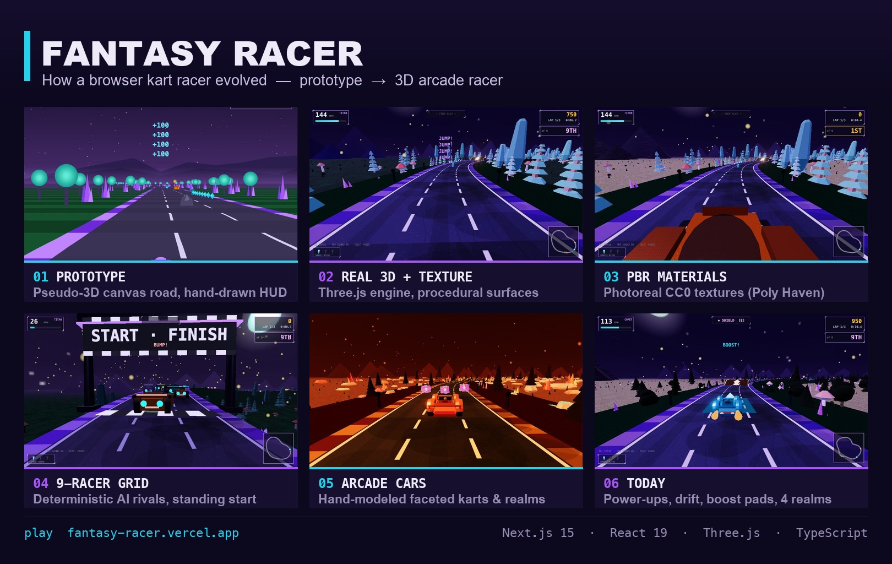
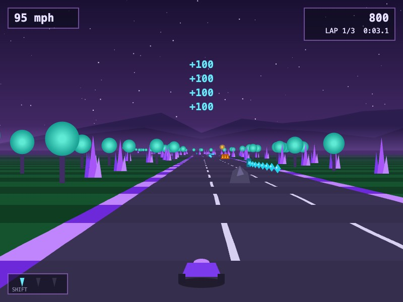
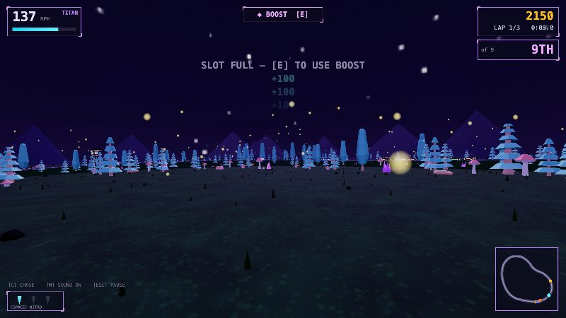
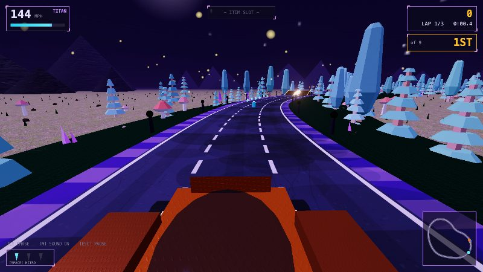
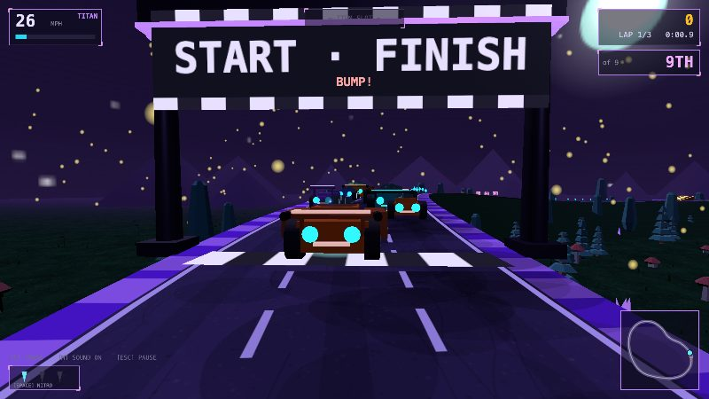
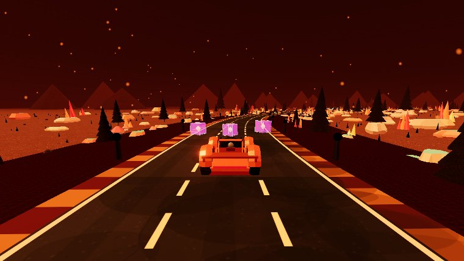
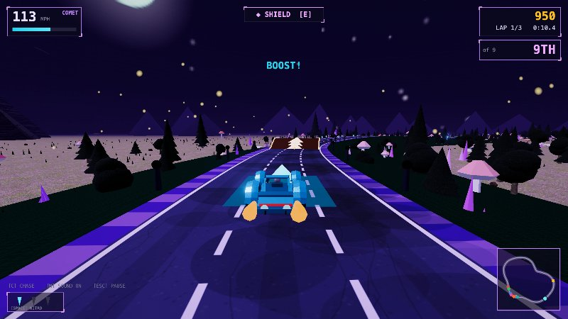

# Fantasy Racer — Evolution

**From a 200-line pseudo-3D canvas prototype to a textured 3D arcade kart racer**, built
with Next.js 15, React 19, TypeScript and Three.js. Live at
**[fantasy-racer.vercel.app](https://fantasy-racer.vercel.app)**.

This page is the before → after story in pictures — drop the montage into a post, or
walk the six stages below.

---

## The one-image story

---

## The six stages

### 01 · Prototype — pseudo-3D canvas
The very first playable build: a single-file **pseudo-3D road renderer** drawn on a 2D
canvas (projected road segments, parallax scenery, a hand-drawn HUD). No 3D engine yet —
just math, `<canvas>`, and a drivable kart.

### 02 · Real 3D + textures
Rebuilt on **Three.js**: a genuine 3D `CatmullRom` track with elevation, hills and a chase
camera, dressed with procedural surfaces and per-realm lighting and fog.

### 03 · PBR materials
Swapped procedural surfaces for **photoreal CC0 PBR textures** (Poly Haven) — ground, road,
rock, bark and metal, each with albedo + normal maps, under ACES filmic tone mapping and
bloom.

### 04 · A field of rivals
A **9-racer grid** with deterministic, name-seeded AI personalities (corner caution, lane
bias, aggression, boost style) lined up under a start/finish gantry.

### 05 · Hand-modeled arcade cars
Faceted, low-poly **"Hot Shot Racing"–style cars** built from scratch in code — stepped
hulls, flared arches, glass greenhouses, visible drivers — across four themed realms.

### 06 · Today
Grip-limited arcade handling with **drift-boost, power-ups, boost pads, ramps and jumps**
across four realms and a Grand Prix mode.

---

## Ready-to-post caption

> I built a 3D fantasy kart racer that runs entirely in the browser 🏎️✨
>
> It started as a 200-line pseudo-3D road drawn on a `<canvas>` — then grew into a real
> Three.js game: PBR-textured worlds, hand-modeled low-poly cars, a 9-racer AI grid with
> distinct personalities, drift-boost, power-ups and four themed realms.
>
> Stack: Next.js 15 · React 19 · TypeScript · Three.js — deployed on Vercel.
> The core rule that kept it sane: the game engine never imports React, and React never
> touches in-race state.
>
> Play it 👉 fantasy-racer.vercel.app
>
> #gamedev #threejs #webgl #typescript #nextjs #react #indiedev

---

*Montage regenerated from in-game captures via `scripts/montage` — see
[PROGRESS.md](PROGRESS.md) for the full milestone-by-milestone devlog.*
