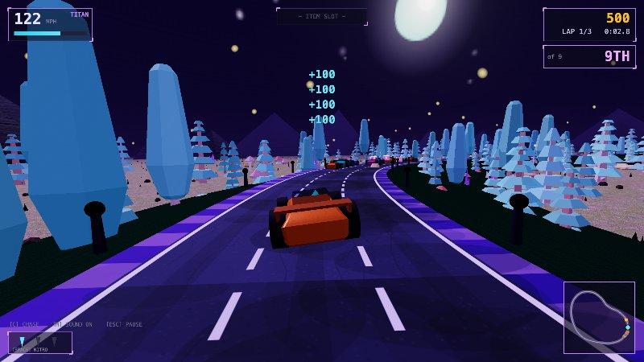
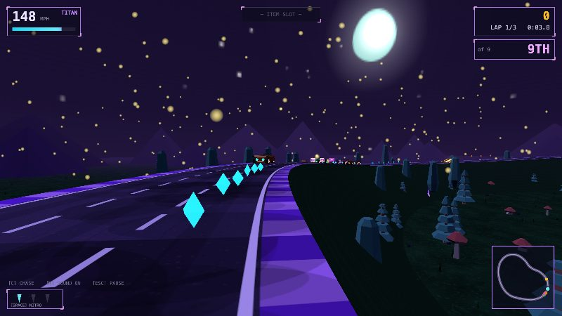
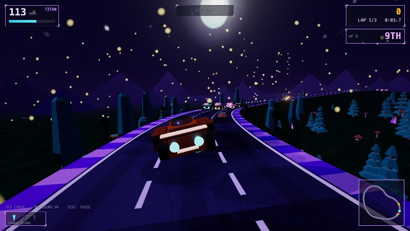
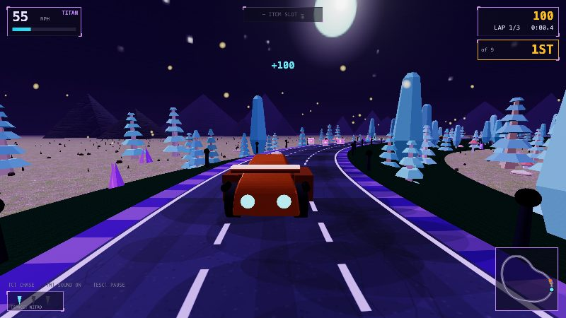
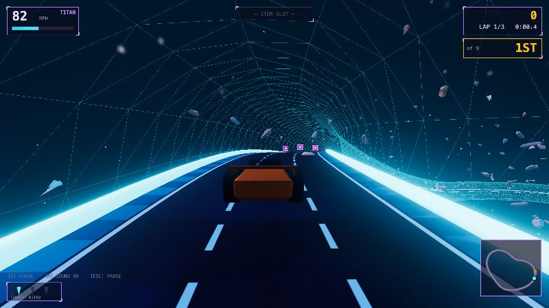
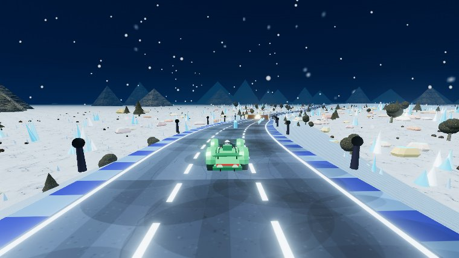
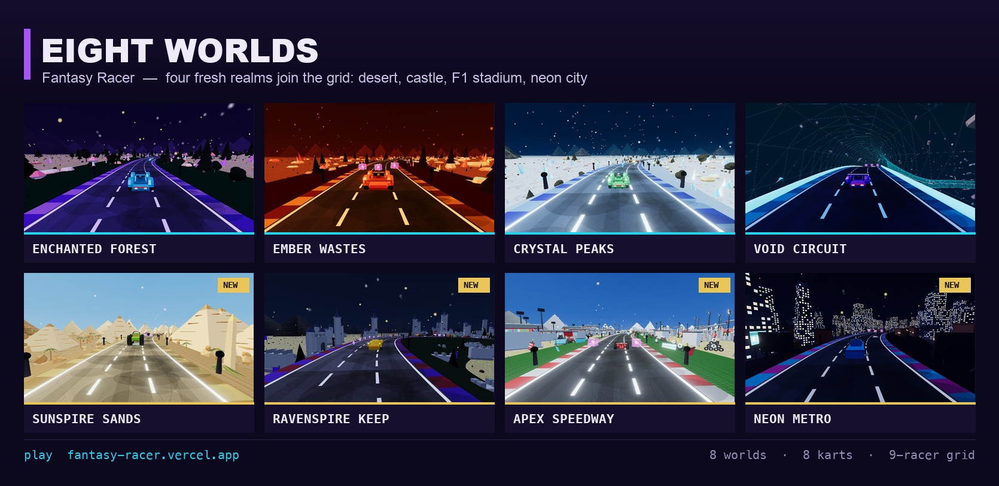

# Fantasy Racer — Progress Log

A fantasy kart racer that started as a single 800×600 canvas and grew into a
full 3D game with four realms, AI opponents, a transforming sword-mech, drift,
stunts, a championship mode, sound, and a global leaderboard.

**Play it:** https://fantasy-racer.vercel.app

> **The full before → after story lives in [EVOLUTION.md](EVOLUTION.md)** — a
> LinkedIn-ready montage plus each stage broken out.

> Screenshots live in `docs/screenshots/`. They're captured straight from the
> game canvas via `renderer.domElement.toDataURL()`.

---

## The evolution, milestone by milestone

Each milestone below shipped and deployed. Times are the order things were
built, not calendar dates.

### 1. Straight road (pseudo-3D)
A vanilla-JS/Canvas OutRun-style renderer: a list of road segments projected
back-to-front with perspective division. Accelerate, brake, steer, rumble
strips, a speed HUD. First playable.

### 2. Curves, hills & mechanics
Curve + elevation on segments, centrifugal force, an out-and-back track,
ramps + mid-air spins, gems, nitro, rocks to dodge, lane-discipline bonuses,
3 laps + timer. Parallax mountains, stars, fog.

### 3. Game shell + Transformer mode
Home screen with name entry and a localStorage leaderboard, countdown/finish
states, and a second mode: grab an orb → morph into a mech that flies and
smashes rocks.

### 4. Next.js + TypeScript
Rebuilt on the Next.js App Router with a strict rule that survives to today:
**the game engine never imports React, and React never touches in-race
state.** They talk only through a `GameOptions` (mode/realm + `onFinish`).

### 5. Real 3D (Three.js)
Threw out the pseudo-3D renderer for actual Three.js: a Catmull-Rom circuit,
a road-ribbon mesh, a chase camera, night sky dome, and **CC0 glTF models**
from Kenney (car + nature kits) for the racer and scenery.

### 6. Realism + maps + AI
Three distinct realms (Enchanted Forest, Ember Wastes, Crystal Peaks) with
their own tracks and palettes, a minimap, **3 AI opponents** with live race
position, 4 modes, camera angles (chase/cinematic/hood), a better mech, and
monster combat in Transformer mode.

### 7. Sound + combat + Grand Prix + global board
Fully **procedural Web Audio** (no assets): a speed-tracking engine hum,
per-event SFX, and an ambient music loop. Monsters that patrol and charge;
opponent bumping. **Grand Prix**: all three realms back-to-back for a
championship. A **global leaderboard** API (Vercel KV / Upstash with a local
fallback).

### 8. Drift, stunts, tube tracks, textures
A lateral-velocity **drift** model (brake+steer to slide, release for a
boost) that fixed the on-rails feel. **Stunt variety**: barrel rolls + flips
+ combos. A **Void Circuit** realm: an anti-gravity glass tube in deep space.
Textured car via the real Kenney atlas.

### 9. Grid, opponents & generated tracks
**8 AI opponents**; the player starts **mid-pack (P5 of 9)** on a real grid.
Tracks are now **generated** as smooth "wobbly-circle" loops with bounded
curvature — no more hand-placed hairpins pinching the road. Full-width menu.

### 10. Visual glow-up + pause/settings (this pass)
**Bloom post-processing** so gems, rails, crystals, nitro, and the sword
actually radiate; brighter, warmer lighting so nothing reads as a black
silhouette. A rebuilt **glowing jump ramp** that sits flush on hills. A
**pause menu** (Esc/P) with **settings** — music/SFX volume, glow toggle,
default camera — all persisted.

### 11. Toned-down glow + power-ups & combat (this pass)
The bloom from milestone 10 was **too strong** — halos everywhere. Dialed it
back (strength 0.9 → 0.4, threshold 0.68 → 0.85) so gems and crystals glint
instead of flare. Then the first roadmap item shipped: **power-ups**. Item
boxes line the track; drive through one to grab a random item into your slot,
fire it with **E**:

- **BOOST** — a short burst above top speed.
- **SHIELD** — a cyan bubble that absorbs the next rock, monster, missile, or
  mine for a few seconds.
- **MISSILE** — a homing projectile that locks the nearest opponent ahead,
  stuns them, and scores a hit.
- **MINE** — drop a hazard behind you; whoever hits it spins out.

Opponents fight back — they scatter mines of their own. Getting stunned makes
a racer spin and bleed speed, so a well-timed missile can flip a position.
Shields block everything and flash **BLOCKED**. Projectiles clear on each new
lap so nothing lingers across the line.

### 12. Full-width, textures, karts & a clean grid (this pass)
A big look-and-feel pass:

- **Full-width, responsive canvas.** The race used to sit letterboxed in a
  4:3 box; now it fills the whole browser at its true aspect ratio and resizes
  live (a `ResizeObserver` re-sizes the renderer, bloom, camera and HUD). The
  HUD was rewritten to be resolution-aware and anchors to the real edges.
- **Real textures & a fuller world.** Ground is now organic multi-scale
  terrain (soft patches + grain, not flat color); the road is proper asphalt
  with aggregate, tire-wear bands, hairline cracks, crisp lane dashes and
  rumble strips. Every realm gets an **ambient particle field** — fireflies in
  the forest, rising embers in the wastes, falling snow on the peaks, drifting
  stardust in the void — plus a lit **START / FINISH gantry** over the line.
- **Four kart types with stats.** COMET (all-rounder), BOLT (top-speed),
  TITAN (heavy launcher), WISP (razor handling) — each a distinct hand-built
  low-poly hull with wheels, canopy, wing/fin and glowing trim. Stats
  (speed / accel / handling, shown as ★ ratings in a new **garage** on the
  home screen) feed real physics multipliers. Opponents now drive an assortment
  of types too, so the grid shows genuine variety.
- **Streamlined starting grid.** Karts line up on a clean staggered 3-column
  grid — no more overlapping/clumped spawns — with the player mid-pack at
  **P5 of 9**.

### 13. Grip, weight & a graded look (this pass)
The driving used to feel like a sprite sliding across a screen — on rails, no
weight. Studied Mario Kart / Hot Shots Racing / Asphalt for what makes them
feel and read well, and rebuilt around it:

- **Grip-limited handling.** Steering now asks the tires for lateral
  acceleration, and the tires have a **grip ceiling** — take a corner too fast
  and you wash wide (understeer), so you have to brake and commit to a line.
  **Weight transfer** (braking loads the front for sharper turn-in),
  **steering inertia** (the wheel eases in and self-centers), **speed-sensitive
  steering** (heavier at top speed), and tire scrub that settles the car. The
  kart visibly yaws into the slip.
- **Camera with feel.** FOV kicks with speed and flares on boost, the view
  banks into corners and looks *ahead into* the turn, and impacts / hard
  landings shake the camera.
- **A graded, finished look.** **ACES filmic tone mapping** + an output pass
  give richer colours and smooth highlight roll-off (the moons and neon now
  bloom cleanly). An **Asphalt-style speed overlay** — vignette + radial
  streaks that build with speed and flare on boost. Glowing **edge-marker
  posts** line the track for a real-circuit look and a speed reference that
  whips past.

**Tuning after playtest feedback:** the tracks were **flattened** so the road
hugs the terrain instead of sitting on a tall embankment (no more "valley"
beside the road); **ambient particles cut** by ~70% and kept low so they don't
bury the cars; **out-of-bounds tightened** (you can put a wheel on the grass
but can't drive off into the scenery); grip made a little more forgiving so you
hold the road; and the **contrast softened** (lifted ambient light + lower
exposure) so it's less harsh neon-on-black.

**Second fix round:** ramps had a collision window narrower than the ramp
itself, so you could drive straight through one — widened it (you now launch
reliably) and added **four ramp kinds** (standard / mega / kicker / wide) with
their own launch power and colour. Item boxes only respond when your slot is
empty; hitting one while full now shows a **"SLOT FULL"** prompt instead of
silently doing nothing, and pickup tolerances were widened so gems/boxes catch
reliably. And the **motion-sickness culprits** were dialled right back — the
FOV kick, camera bank, look-ahead swing and shake are now gentle, and the speed
streaks no longer strobe (re-seeded ~5 Hz, far fewer, faint), with bloom
reduced so bright edges don't halo.

### 14. Real textures, curved ramps & a brighter world (this pass)
The long-standing ask: **texture**. Everything was flat-shaded solid colour, so
nothing read as a real surface. Added a procedural texture module and wired it
through:

- **Cars** wear brushed-metal panelling (a grayscale map that multiplies the
  livery colour, plus a bump map for seams + rivets that catch the light).
- **Road** is proper asphalt now (colour map + aggregate bump — grain and
  hairline relief), **ground** has terrain bump, and **rocks / crystals** get
  cracked-stone colour + bump. The CC0 nature props (trees, mushrooms) were
  switched to a lit, lightly bump-textured material so they stop looking flat.
- **Curved ramps.** The ramps were straight wedges; they're now genuinely
  **curved** surfaces (built from a slope profile) — a smooth standard, a
  concave mega kicker, a sharp late-kick, and a quarter-pipe — with glowing
  rails that follow the curve.
- **Ramp launches no longer throw you off track** — you launch straight (no
  sideways carry), snap toward the ramp's centre, and land back on the road.
- **Brighter, clearer world.** The scenes were so dark the textures (and the
  cars) were hard to see and everything read as harsh neon-on-black. Raised the
  key light, ambient and exposure so surfaces and their texture actually read,
  which also softened the contrast.

**Polish round:** ramps sometimes did nothing because they'd been centred in
one lane while the hit window was narrower than a lane — now they **span the
full road** (and the window with them), so you launch from any line. The
**glow was dialled back** (bloom + emissive intensities down, edge-post markers
and neon kerbs dimmed) so it's less distracting, and the forest gets
**per-instance colour variation** so it's not a wall of identical trees.

### 15. Real CC0 PBR textures (this pass)
Swapped the hand-drawn canvas textures for **real 1K CC0 PBR sets from Poly
Haven** (`public/textures/`, public domain): a per-realm ground (forest floor /
red volcanic soil / snow), asphalt, rock, and metal — each with an albedo +
normal map. They load asynchronously alongside the models, so the **ground now
has genuine terrain detail**, the **road is real asphalt** (procedural lane
markings kept, real normal for the surface), **rocks and mountains** use a rock
set, and the **cars** get metal-plate surface relief from a normal map while
keeping their bright livery colour. Falls back to the procedural maps if a set
fails to load.

### 16. Real rivals, editable laps, a proper home screen (this pass)
The opponents felt fake — they clustered around the player and ignored
everything. Fixed:

- **They string out** now: each rival holds its own top-speed **pace** (1.02
  down to 0.86) instead of rubber-banding to the player, so the field spreads
  across the track (a 15-second sim spread them ~140 m apart).
- **They hop the ramps** (full ballistic launch, any lane) and **fire nitro
  bursts** with rear flames — verified opponents reaching ~4.6 m of air.
- **Editable laps**: pick 1 / 2 / 3 / 5 / 7 before the race (single-race modes),
  threaded through `GameOptions`.
- **Cars aren't stacked boxes** anymore — the hull is a single **extruded car
  silhouette**, tapered narrower toward the cabin so it reads as a rounded car
  from behind (the main camera), each type its own shape + livery.
- **Home screen redesign**: animated gradient title, tagline, feature chips,
  pill lap-selector, a proper gradient CTA that shows the lap count, richer
  background, and hover-lift cards.
- A touch more **ambient light** so the textures and scene read better.

### 17. Real cars, rival brains, a proper asteroid field (this pass)
A big multi-front pass (two focused sub-agents rebuilt the cars and the AI in
parallel while the engine work went in alongside):

- **Cars are actual cars now.** Rebuilt each kart as a smooth width-tapered
  hull (tucked sills, full fenders, a narrow glass greenhouse, sloped
  windshield/backlight), real tyres + rims with a suspension gap, headlights,
  a slim tail-light bar, and type-specific wings — comet/bolt/titan/wisp each a
  distinct silhouette. Emissive dialled right down.
- **Each rival has a brain.** Every opponent now has a deterministic
  personality seeded from its name: cornering caution (some send it and wash
  wide, some brake clean), a preferred racing line + how much it weaves, apex
  aggression, its own nitro trigger (straights / corner-exit / comeback /
  wildcard) and cadence, and mistake-proneness by skill — so no two race alike.
- **Cars no longer sink into the road** (the surface renders slightly above the
  centreline; cars are lifted to sit on it).
- **The space realm looks like space.** A dense floating **asteroid field**
  (textured rock chunks at varied sizes/depths, some huge and distant) around
  the glass tube, plus a ringed **gas-giant** backdrop.
- **Calmer + fuller:** bloom + emissives cut again (no blown-out glow), the
  fixed square "stars" are now soft round dots, three scenery bands fill the
  empty flats, ramp collision widened (no clipping the sides; every rival hops),
  and the car's lean/slip on turns reduced so it stops shearing.

### 18. Stage 2 — real cars, textured trees, a wizard menu (this pass)
Three focused sub-agents + engine work, in parallel:

- **Cars now read as real cars** (Hot-Shot-Racing / arcade-GT feel): crisp
  *faceted* (flat-shaded) bodywork instead of a smooth blob — a front grille +
  bumper, flared **wheel arches** over every tyre, a proper greenhouse with
  slanted windshield/backlight and A/B **pillars**, and a **visible driver**
  (helmet) in the cockpit; distinct silhouettes per type (GT coupe / long
  prototype / wide muscle-car / open kart), glow kept subtle.
- **Textured trees.** Swapped the flat kit foliage for procedural trees with a
  real **bark** trunk and **leaf** canopy (CC0 Poly Haven bark + foliage
  textures), tinted per realm — the world finally has surface texture, not just
  shaded shapes.
- **The menu is a 3-step wizard.** Map → Machine → Race, with a **real preview
  image above every realm and car**, a breadcrumb + progress rail, back/next,
  and a "professionally funky" neon layout — captured straight from the game.
- Cars **no longer sink** into the road; opponents each have a **distinct
  personality** (cornering, lane bias, boost strategy); the **void** is a dense
  **asteroid field** with a gas-giant backdrop; glow, stars, density and turn
  feel all tuned.

### 19. Easier to control + more to do on track (this pass)
- **Handling is much more forgiving.** Cranked up grip and steering response and
  eased the centrifugal push — the car now holds its line instead of washing
  wide, so it's arcade-easy to control (a hold-the-line test that used to drift
  ~1.35 off-centre now stays within ~0.33), with a slightly more generous
  out-of-bounds margin.
- **Boost pads.** Glowing chevron pads on the track — drive over the arrows for
  a speed surge. Something to aim for on every lap.
- **Livelier tracks.** Gem runs are now patterned (straight / zigzag /
  lane-sweep) as mini skill lines, ramps come ~25% more often, and the forest
  and ember layouts got extra corner harmonics so the circuits have more
  character (tighter turns + sweeps) instead of one monotonous curve.

---

## Eight machines + a live 3D garage

The roster doubled to **eight karts**, and the select screen became a real
showroom.

**Four new cars**, each a distinct hand-built silhouette (not recolors):

- **APEX** — a Formula open-wheeler: pointed nose cone, exposed wheels on
  suspension arms, front + rear wings, driver halo, airbox.
- **GOLIATH** — a monster truck towering on four enormous tyres, with a roll
  cage and visible shocks.
- **CORSAIR** — a landlocked galleon: raised bow, portholed deckhouse, a mast
  and pennant.
- **BARON** — an absurd **six-wheel** stretch limo with a row of side windows.

Each carries its own speed / accel / grip, so the pick changes how it drives.

**The garage is now a live 3D showroom.** Instead of a flat thumbnail, the
chosen car rotates in a lit studio with a soft contact shadow — built from the
exact same mesh the race uses (`makeKart`), so it never drifts from the in-game
model and there are no pre-rendered images to go stale. It scales to any number
of cars for free.

And the docs got what they were missing: a **before → after evolution gallery**
(the montage up top, and **[EVOLUTION.md](EVOLUTION.md)**) — six stages from the
day-one pseudo-3D canvas to today, each captured straight from that build.

---

## Eight worlds

Four new themed realms join the original four:

- **Sunspire Sands** — a blazing Egyptian desert of pyramids, obelisks and palms.
- **Ravenspire Keep** — a torchlit medieval castle circuit with towers, ramparts and banners.
- **Apex Speedway** — a real F1 stadium: grandstands, tyre barriers, floodlights, red-and-white kerbs.
- **Neon Metro** — a midnight New-York street circuit under a skyline of lit towers and neon billboards.

Each realm ships its own track shape, sky, lighting and a full set of hand-built
procedural props (a dedicated builder file per theme), and drops straight into the
same wizard, Grand Prix and time-trial flow as the rest.

---

## Where it stands now

- **8 realms**: Enchanted Forest, Ember Wastes, Crystal Peaks, Void Circuit,
  Sunspire Sands (Egypt), Ravenspire Keep (castle), Apex Speedway (F1 stadium),
  Neon Metro (NYC)
- **8 karts**: Comet, Bolt, Titan, Wisp, Apex (F1), Goliath (monster truck),
  Corsair (ship), Baron (limo) — each a distinct model + stat line, picked in
  a live 3D garage
- **5 modes**: Classic, Time Trial, Nitro Sprint, Transformer Rush, Grand Prix
- **9-racer grid** with live position + a top-down minimap
- **Grip-limited handling** (weight transfer, drift + boost) with a camera
  that banks and kicks FOV; barrel-roll/flip **stunts** with combos
- **Transformer mech** with an energy sword + monster combat
- **Power-ups**: boost / shield / homing missile / mines, item boxes, and
  opponents that fight back — press **E** to fire
- **Bloom** + **ACES tone mapping**, speed-FX overlay, edge-post markers,
  procedural sound, pause + settings
- **Global leaderboard** (activates fully once a KV store is connected)

**Stack:** Next.js 15 · React 19 · TypeScript · Three.js · Web Audio ·
Vercel. Assets: Kenney CC0 kits. ~60 fps (measured ~1.4 ms/frame with bloom).

---

## Gameplay roadmap (next)

The look and UX are in good shape; the next arc is depth of play.

- ~~**Power-ups & combat**~~ — ✅ shipped in milestone 11: item boxes, boost,
  shield, homing missile, mines, and opponents that fight back.
- ~~**Karts & a garage**~~ — ✅ eight distinct karts with their own speed /
  accel / handling, chosen in a live 3D showroom. Still open: unlocks, gems as
  currency, progression milestones.
- **More content & routes** — shortcuts and alternate paths, hazards,
  weather / time-of-day variety, more tracks and modes.
- **Feel & polish** — real counter-steer drift, boost chaining, speed lines,
  screen shake, dynamic camera, juicier hit/pickup feedback.

Also open: textured foliage (the nature kit ships no atlas — needs custom UV
maps), banked curves, a shared KV leaderboard, and touch controls for mobile.
